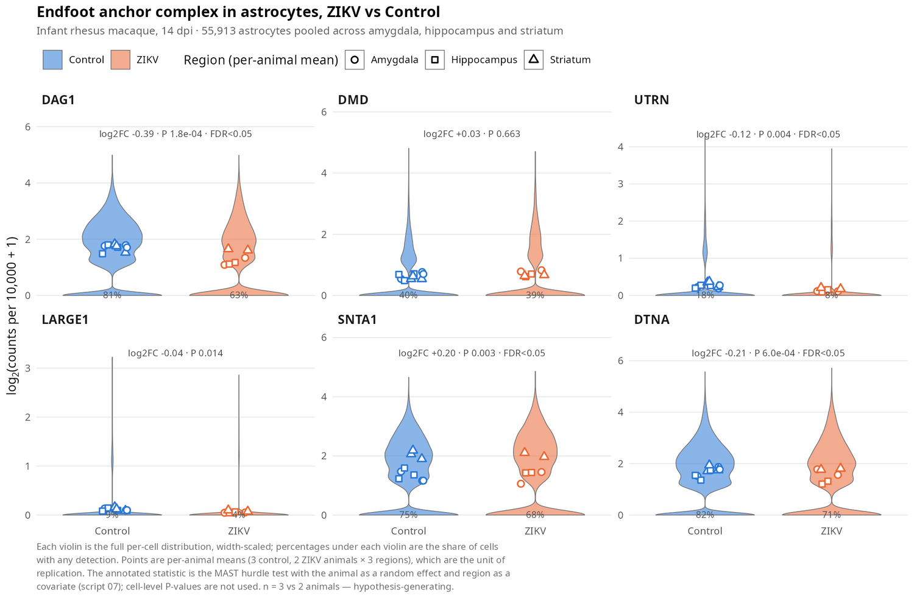

# Macaque — the astrocyte endfoot after infant ZIKV infection

Re-analysis of **GEO [GSE342497](https://www.ncbi.nlm.nih.gov/geo/query/acc.cgi?acc=GSE342497)**
(Edara et al., *JCI Insight* 2026) asking what an infant macaque brain says about the perivascular
machinery that [Doerl et al. 2025](https://doi.org/10.1101/2025.10.26.684625) place at the centre of
glymphatic protection against Zika virus.

**[→ Open the report](https://mcblab.github.io/Doerl_2025/macaque/)** (self-contained HTML, also
`index.html` in this folder)

## Why this dataset

Doerl et al. report that a mature glymphatic system is an innate barrier to ZIKV. Injected into the
lateral ventricle of a P1 mouse, before maturation, the virus spreads widely, deforms vessels and
disrupts the Aqp4⁺ astrocyte network, with reduced AQP4 coverage of vessels and recruitment of CD45⁺
leukocytes. After maturation the same challenge causes neither disease nor persistent infection, and
pharmacological inhibition of vasopressin receptor 1a — which reduces perivascular fluid dynamics —
reopens the window of susceptibility.

GSE342497 is the complementary case: **infant rhesus macaques infected at 4 weeks of age**, which is
past the equivalent maturation window, sampled 14 days post-infection in amygdala, hippocampus and
striatum. If the mouse model is right, this brain should be protected — and it largely looks it. The
question this analysis asks is what happens to the *anchoring* machinery regardless.

| | Doerl et al. 2025 | GSE342497 (Edara et al. 2026) |
|---|---|---|
| Model | Mouse | Infant rhesus macaque |
| Route | Lateral-ventricle injection | Subcutaneous, 1 × 10⁵ PFU, PRVABC59 |
| Age at infection | P1 (immature) vs after maturation | 4 weeks — past the window |
| Readouts | Disease, viral spread, vessel shape, AQP4 coverage/pattern, CD45⁺ cells, V1aR blockade | scRNA-seq (3 regions), histology, diffusion MRI, behaviour |

> The preprint's full text could not be retrieved programmatically (the publisher blocks automated
> access). Statements about it here come from its abstract and the preLights highlight including the
> authors' replies. Figure-level detail, mouse ages beyond P1 and the V1aR experiment's design were
> not available and are not assumed anywhere in this analysis.

## What the analysis found

**Consistent with a protected, mature brain**

- Zero viral UMIs in 176,570 cells. Weak evidence on its own — the ZIKV genome has no poly(A) tail,
  so 10x 3′ oligo-dT capture is close to blind to it.
- `AQP4` transcript is flat in astrocytes in all three regions and in both astrocyte subtypes.
  Apparent AQP4 increases in cells that do not express it track astrocyte ambient RNA (r = 0.87).
- No influx of blood-derived leukocytes (0.3–1.7% of cells in both arms).

**New: the anchoring module is coordinately lower**

In astrocytes of amygdala and hippocampus the whole perivascular anchoring complex falls together,
strongest in GFAP-high astrocytes:

| Gene | Amygdala | Hippocampus | Striatum |
|---|---|---|---|
| `DAG1` (GFAP-hi) | −0.68, FDR 0.0096 | −0.72, FDR 0.023 | −0.44, P 0.024 |
| `NID1` (GFAP-hi) | −1.03, FDR 0.0058 | −0.71, FDR 0.022 | −1.38, FDR 0.0042 |
| `LAMB2` (GFAP-hi) | −0.99, FDR 0.0046 | ns | ns |
| `KCNJ10` (GFAP-hi) | −0.73, FDR 0.0049 | −0.67, FDR 0.049 | ns |
| `MLC1` (GFAP-hi) | −0.46, FDR 0.027 | −0.51, FDR 0.041 | ns |
| `LARGE1` (GFAP-hi) | −0.93, FDR 0.046 | ns | ns |
| `HSPG2` / `LAMC1` (GFAP-hi) | ns | −1.21 / −1.19, FDR 0.046 / 0.049 | ns |
| `DAG1` (all astrocytes) | −0.60, P 0.006 | **−0.71, FDR 0.036** | 0.00 |

Values are log₂ fold change, ZIKV vs control. `AQP4`, `SNTA1` and `DTNA` do not change.

Pericytes lose the same basement-membrane transcripts — `LAMB2` (−1.09 / −1.38, FDR 0.015 / 0.012),
`AGRN` (−0.82 / −0.92), `COL4A2` (−0.81 / −0.83) in amygdala and hippocampus — so this is a shared
perivascular signature rather than one cell type drifting.

**Inflammation is resident, not recruited.** Interferon-stimulated genes rise in microglia
(`ISG15` +2.32, FDR 0.013 in amygdala), endothelium (hippocampal `ISG15`, `IFI6`, `MX1`, `STAT1` all
FDR < 0.05), OPCs and oligodendrocytes (`MX1` up to +5.25, FDR 0.012).

**`AVPR1A` (V1aR) is a mural and neuronal transcript here**, essentially absent from astrocytes
(control log₂(CPM+1): immature excitatory neurons 3.09, PENK⁺ neurons 2.78, smooth muscle 2.63,
pericytes 2.03, astrocytes 0.06). It is testable only in hippocampal immature excitatory neurons,
where it does not change.

**`DMD`** rises modestly in pericytes (+0.6 to +0.8, nominal in all regions) and in oligodendrocytes
(amygdala +1.21, FDR 0.041). Dp71 — the isoform that actually anchors AQP4 — cannot be separated from
total `DMD` with 3′ chemistry.

### Cell-level view: MAST

The pseudobulk above sums each animal's cells into one value. A cell-level hurdle model (MAST) asks instead whether
the *fraction of astrocytes expressing* the anchor changes. Fitted with the animal as a random effect:

| Gene | All astrocytes (log₂FC, P) | Detected ctrl → ZIKV | GFAP-high astrocytes | Detected ctrl → ZIKV |
|---|---|---|---|---|
| `DAG1` | −0.39, P 1.8e-4 ** | 81% → 63% | −0.44, P 3.0e-7 ** | 80% → 59% |
| `DTNA` | −0.21, P 6.0e-4 ** | 82% → 71% | −0.09, P 1.8e-3 ** | 78% → 69% |
| `UTRN` | −0.12, P 3.5e-3 ** | 18% → 8% | −0.08, P 0.059 | 16% → 7% |
| `LARGE1` | −0.04, P 0.014 * | 9% → 4% | −0.05, P 1.6e-4 ** | 8% → 4% |
| `SNTA1` | **+**0.20, P 3.3e-3 ** | 75% → 68% | **+**0.21, P 1.0e-3 ** | 78% → 76% |
| `DMD` | +0.03, P 0.66 | 40% → 39% | +0.10, P 0.175 | 35% → 36% |

`**` FDR < 0.05, `*` P < 0.05. MAST pools the three regions with region as a covariate, so these do not map
one-to-one onto the per-region pseudobulk.

> **Pseudoreplication is severe in this dataset, and the numbers show it.** Fitting the same MAST model the
> conventional way — all 176,570 cells as independent replicates — gives `DAG1` in astrocytes **P = 3×10⁻²⁹⁵**.
> Adding `(1|animal)` moves it to **P = 1.8×10⁻⁴**: 291 orders of magnitude. Across the six genes the median shift is
> 2.3 orders and **18 of 58** cell-level "significant" results stop being significant. The fixed-effects table is
> shipped (`mast_panel_..._FIXED_pseudoreplicated.csv`) for effect sizes and detection rates only — **do not cite its
> P-values**. Even the random-effect fit rests on a variance estimated from five animals, so treat it as optimistic.
> `SNTA1` rising here while flat in pseudobulk reflects the two methods weighting detection rate versus level
> differently; it is not a separate finding. See [Squair et al. 2021](https://doi.org/10.1038/s41467-021-25960-2).



### Is this really one complex?

Yes — and that matters, because the argument rests on these six genes being one structure rather than six genes that
drift together. α-dystroglycan (`DAG1`) binds laminin and agrin in the basement membrane through *matriglycan*, the
sugar built by `LARGE1`; β-dystroglycan passes the link inward to dystrophin (`DMD`, glial isoform Dp71) or utrophin
(`UTRN`), which scaffold α-syntrophin (`SNTA1`) and α-dystrobrevin (`DTNA`); α-syntrophin's PDZ domain binds the AQP4
C-terminus directly. Every loss-of-function phenotype in that chain is **AQP4 present but depolarised**, not AQP4
absent — which is the pattern here. [Yang et al. 2024](https://doi.org/10.1016/j.nbd.2024.106586) closes the loop by
showing Dp71 loss impairs **glymphatic** function specifically.

**→ [`endfoot_anchor_references.md`](endfoot_anchor_references.md)** — the gene-by-gene primary literature, every
entry verified against PubMed (PMID, journal, volume, pages, DOI).

### The honest reading

This dataset cannot see AQP4 *coverage* of vessels, which is what the mouse study measures; and the
mouse study does not report these transcripts. What the macaque data add is a plausible molecular
route to the same phenotype, in a brain that was supposed to be protected. **AQP4 and β-dystroglycan
immunostaining on the archived macaque tissue, scored as perivascular polarisation, is the experiment
that would connect them.**

## Caveats

- **Three controls versus two infected animals.** No panel gene survives correction across the full
  targeted set; reported FDRs are genome-wide within one region × cell type. Hypothesis-generating.
- **Infection is confounded with processing batch.** Nothing in the design separates them.
- **Ambient RNA is worse in the ZIKV libraries**, and it is vascular, not only astrocytic: `ACTA2`
  appears to rise 3–4 log₂ in astrocytes and microglia, which barely express it, while rising only
  ~0.5 in the smooth muscle cells that make it. Every change is re-tested after subtracting an
  estimated foreign-signal contribution from every other cell type (`contamination.R`); those that do
  not survive are flagged †. The decreases above run *opposite* to contamination, which is why they
  are the most credible signal.
- **Region labels in GEO are swapped** (hippocampus ↔ striatum) relative to the file names. The file
  names are correct and are what this analysis uses: `_Stri_` libraries carry PPP1R1B⁺/PENK⁺ cells,
  lateral-ventricle ependymal cells and DLX⁺ SVZ neuroblasts; `_Hipp_` libraries carry
  PROX1⁺/NEUROD2⁺ granule-like neurons and choroid plexus. The GEO title is kept as `region_GEO_title`.
- **Whole-cell preparation, few neurons** (~40% microglia, ~30% astrocytes). Mature neurons are rare,
  so neuronal results are underpowered.
- **mRNA is not protein, and certainly not localisation.**

## Layout

```
macaque/
├── index.html                      the report — self-contained, open it directly
├── endfoot_anchor_references.md    primary literature for the anchor architecture
├── figures/                        PNGs (01–07 primary, 08–09 endfoot violins, annotation dot plot)
└── scripts/                        the pipeline, run in numeric order
```

| Script | Does |
|---|---|
| `01a_per_sample_qc.R` | emptyDrops cell calling, QC filters, scDblFinder |
| `01b_merge_integrate.R` | 3,000 consensus HVGs, PCA, Harmony by sample, UMAP, clustering |
| `02a_explore_markers.R`, `02b_annotate.R` | marker-based annotation, neuronal sub-clustering |
| `03_de_target_genes.R` | pseudobulk per animal × region × cell type, edgeR QL, full transcriptome |
| `03b_figures.R` | figures 01–07 |
| `04_build_full_object.R` | assembles the annotated Seurat object (not versioned here) |
| `05_glymphatic_context.R` | the extended panel and `report_data.json` |
| `06_build_report.R` | renders `index.html` from `report_template.html` |
| `07_mast_celltype.R` | cell-level MAST per cell type, with and without the animal random effect |
| `08_violin_endfoot.R` | the endfoot-anchor violin figures (08, 09) |
| `contamination.R` | the shared ambient-RNA / doublet correction |

## Running it

The scripts carry a hard-coded project root:

```r
proj <- "/home/diego-coelho/Documents/mcblab/Edara2026"
```

Change it, then from GEO GSE342497 download the raw 10x matrices into `data/` and run the scripts in
numeric order. Needs R with Seurat v5, edgeR, harmony, scDblFinder, DropletUtils, MAST, lme4, dplyr, ggplot2,
jsonlite and magick. Step `04` needs about 13 GB of RAM; steps `05` and `06` are light.

**Not in this repository:** the 2.5 GB annotated Seurat object, the raw and intermediate matrices, and
the CSV result tables (including the MAST tables — ask if you want them added; they are small). The figures and the report are the versioned outputs.

## References

1. Doerl JG, Chaves EKC, dos Santos VAB, Marcelino BLM, Coelho DM, Miyakoshi LM, Araujo JMG,
   Jeronimo SMB, Sequerra EB. *Maturation of the glymphatic system confers innate resistance of the
   brain to Zika virus infection.* bioRxiv 2025.10.26.684625 (2025).
   [doi:10.1101/2025.10.26.684625](https://doi.org/10.1101/2025.10.26.684625) — not peer reviewed.
2. [preLights highlight and author Q&A](https://prelights.biologists.com/highlights/maturation-of-the-glymphatic-system-confers-innate-resistance-of-the-brain-to-zika-virus-infection/) on the above.
3. Edara VV, et al. *Disrupted neuronal expression of autism risk genes and white matter
   micro-organization after infant Zika infection.* JCI Insight 11(21):e203088 (2026).
   [doi:10.1172/jci.insight.203088](https://doi.org/10.1172/jci.insight.203088)
4. Munk AS, et al. *PDGF-B is required for development of the glymphatic system.* Cell Rep
   26:2955–2969 (2019). [doi:10.1016/j.celrep.2019.02.050](https://doi.org/10.1016/j.celrep.2019.02.050)
5. Amiry-Moghaddam M, et al. *An α-syntrophin-dependent pool of AQP4 in astroglial end-feet confers
   bidirectional water flow between blood and brain.* PNAS 100:2106–2111 (2003).
   [doi:10.1073/pnas.0437946100](https://doi.org/10.1073/pnas.0437946100)
6. Noell S, et al. *Evidence for a role of dystroglycan regulating the membrane architecture of
   astroglial endfeet.* Eur J Neurosci 33:2179–2186 (2011).
   [doi:10.1111/j.1460-9568.2011.07688.x](https://doi.org/10.1111/j.1460-9568.2011.07688.x)
7. Yang J, et al. *Dystrophin 71 deficiency causes impaired aquaporin-4 polarization contributing to
   glymphatic dysfunction and brain edema in cerebral ischemia.* Neurobiol Dis 199:106586 (2024).
   [doi:10.1016/j.nbd.2024.106586](https://doi.org/10.1016/j.nbd.2024.106586)
8. Finak G, et al. *MAST: a flexible statistical framework for assessing transcriptional changes and
   characterizing heterogeneity in single-cell RNA sequencing data.* Genome Biol 16:278 (2015).
   [doi:10.1186/s13059-015-0844-5](https://doi.org/10.1186/s13059-015-0844-5)
9. Squair JW, et al. *Confronting false discoveries in single-cell differential expression.*
   Nat Commun 12:5692 (2021). [doi:10.1038/s41467-021-25960-2](https://doi.org/10.1038/s41467-021-25960-2)

Gene-by-gene evidence for the endfoot architecture is in
[`endfoot_anchor_references.md`](endfoot_anchor_references.md).
